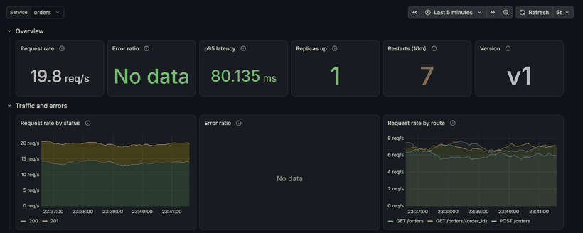
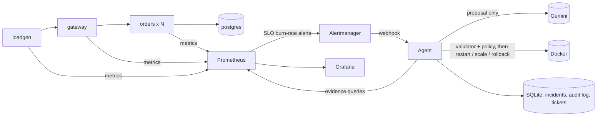

# ReliaLoop

A small microservice system with SLOs as code, burn-rate alerting and fault injection, plus an agent that diagnoses incidents, proposes a fix, and applies it only after deterministic safety checks. A rule engine and an LLM (Gemini) do the diagnosis, and both were evaluated on the same injected faults.



## What it does

When an SLO starts burning its error budget, the system runs one loop:

1. **Detect.** Prometheus evaluates multi-window burn-rate rules generated from `slo/*.yaml`; Alertmanager pages the agent.
2. **Diagnose.** The agent collects evidence (metrics, logs, deploy history) and a rule engine or an LLM names the fault and the service at its root.
3. **Validate.** A validator checks the proposal against the facts: cited evidence must exist, the action must be allowed for that service, a rollback needs a recent deploy.
4. **Remediate.** A policy engine decides. Restart and scale-out run automatically within rate limits; a rollback waits for a human to approve.
5. **Verify.** The agent watches the SLO until it is healthy for three checks in a row, then writes a ticket and a postmortem. If it is not, it escalates.

**The LLM only proposes; it never executes.** It sees collected evidence, returns a structured proposal, and that proposal goes through the same validator, policy engine and approval step as the rule engine's. If the LLM fails, the rule engine takes over.

## Architecture



## Results

Measured on 2026-11-13 on one laptop. Two full attempts, each one run per scenario per mode (n = 2 per row). `none` is the control: no remediation.

| Scenario | Mode | Correct diagnosis | Correct action | Recovery verified | Time to mitigate |
|---|---|---|---|---|---|
| error_spike | none | n/a | n/a | n/a | not recovered (2/2) |
| error_spike | rules | 2/2 | 2/2 restart | 2/2 | 52 s, 62 s |
| error_spike | llm | 2/2 | 2/2 restart | 2/2 | 62 s, 63 s |
| latency_saturation | none | n/a | n/a | n/a | not recovered (2/2) |
| latency_saturation | rules | 2/2 | 2/2 scale out | 2/2 | 56 s, 56 s |
| latency_saturation | llm | 2/2 | 2/2 scale out | 2/2 | censored, 62 s |
| crash_loop | none | n/a | n/a | n/a | not recovered (2/2) |
| crash_loop | rules | 2/2 | 2/2 rollback (approved) | 2/2 | 73 s, 74 s |
| crash_loop | llm | 2/2 | 2/2 rollback (approved) | 2/2 | 62 s, 65 s |

No wrong action was executed in any run.

**Caveat on timing.** In these two attempts each fault was injected before the alert windows of the previous run had emptied, so alerts fired early (6 to 17 s). Those detection times are optimistic and are not shown, and the times to mitigate above inherit the same bias. Diagnosis, action and recovery results are not affected. Three control runs made after the harness was fixed to start from a clean baseline measured detection at **46.5 s** (crash_loop), **24.1 s** (error_spike) and **16.1 s** (latency_saturation); the `rules` and `llm` runs were not repeated from a clean baseline.

Also note: tiny sample, synthetic faults, a demo alerting profile that compresses hours into minutes, and rollback approvals given instantly by the harness. "Censored" means the gateway had not been within its objectives for 30 s when the run ended. Raw data and details: [docs/results](docs/results/README.md).

## Quick start

Prerequisites: Docker Desktop (running), Python 3.11 or newer. A Gemini API key is optional; without one the agent uses the rule engine.

Commands are for Windows PowerShell. On Linux or macOS use `.venv/bin/python` instead of `.venv/Scripts/python.exe`.

```powershell
python -m venv .venv
.venv/Scripts/python.exe -m pip install -r requirements-dev.txt
.venv/Scripts/python.exe -m tools.cli init
.venv/Scripts/python.exe -m tools.cli build
.venv/Scripts/python.exe -m tools.cli up
```

`up` prints the URLs when everything is healthy. Open Grafana at http://localhost:3000 (no login) and pick the **Service Golden Signals** dashboard.

Run one demo: let the agent act, then make half of the `orders` requests fail.

```powershell
.venv/Scripts/python.exe -m tools.cli mode enforce
.venv/Scripts/python.exe -m tools.cli chaos errors --service orders --rate 0.5
.venv/Scripts/python.exe -m tools.cli incidents list
.venv/Scripts/python.exe -m tools.cli incidents show INC-...
```

About 20 seconds after the fault an incident appears; about a minute later it is `RESOLVED`. Then stop:

```powershell
.venv/Scripts/python.exe -m tools.cli mode observe
.venv/Scripts/python.exe -m tools.cli down
```

Full walkthrough, including the rollback approval and what every dashboard panel means: [docs/DEMO.md](docs/DEMO.md).

## Project structure

```
services/       demo services (gateway, orders, loadgen) and a shared kit: metrics, logging, chaos
slo/            SLO specs; the alert rules are generated from these
observability/  Prometheus rules and rule tests, Alertmanager config and tests, Grafana dashboards
agent/          the agent: evidence, diagnosis (rules and LLM), validator, policy, actions, verification, postmortems
cmdb/           service catalog: owners, dependencies, allowed actions, limits
tools/          the CLI, SLO rule generator, error-budget deploy gate, dashboards as code
libs/           small shared library (gate decision, naming)
eval/           evaluation harness: scenarios, runner, measurement, report
deploy/         versions the stack currently runs
docs/           design notes, demo walkthrough, runbooks, ADRs, results, example postmortems
```

More detail: [docs/DESIGN.md](docs/DESIGN.md) (design, safety model, known limitations), [docs/alerting.md](docs/alerting.md), [docs/slo-design.md](docs/slo-design.md), [docs/runbooks](docs/runbooks/).

## Tech stack and licence

Python 3.12, FastAPI, PostgreSQL, SQLite, Docker Compose, Prometheus, Alertmanager, Grafana, Gemini (`google-genai`), pytest, ruff, mypy, GitHub Actions.

The CI workflow is included but has not been run yet (the repository had not been pushed when this was written).

MIT licence. See [LICENSE](LICENSE).
