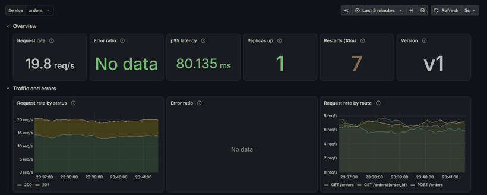
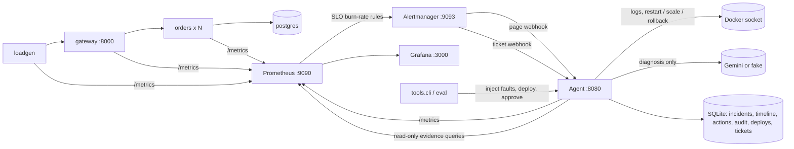
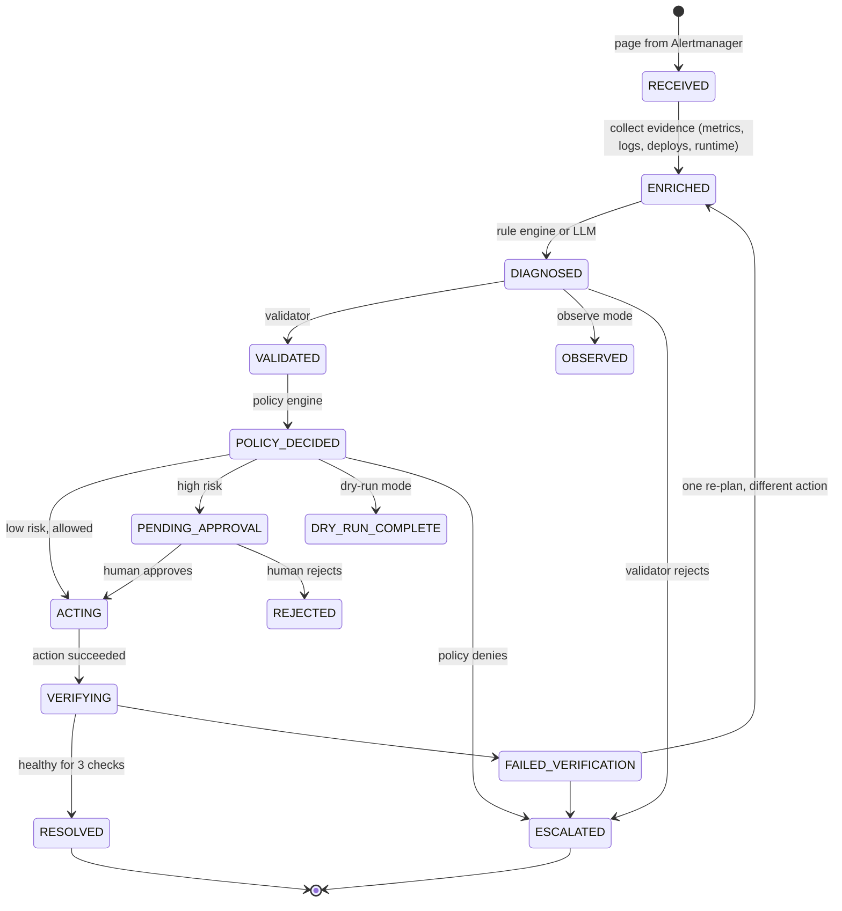

# ReliaLoop design notes

The longer companion to the [README](../README.md): what the project demonstrates, how the pieces fit, the measured results and the known limitations. For a step-by-step walkthrough see [DEMO.md](DEMO.md).

A small microservice system with **SLOs as code**, multi-window burn-rate alerting, fault injection, and an **AIOps agent** that diagnoses incidents from evidence, proposes a remediation, passes it through a validator and a policy engine (with human approval for risky actions), executes it, **verifies recovery**, and writes a blameless postmortem.

The agent has two diagnosis engines, a deterministic rule engine and an LLM (Gemini), and both are **evaluated on the same injected faults with measured results**. The LLM never executes anything: it only proposes, and the same validator, policy engine and approval step stand between any proposal and the system.

This is a portfolio project. It runs on one machine with Docker Compose and favours clarity and honesty over scale. What is not built is listed under [Known limitations](#known-limitations).



*The Service Golden Signals dashboard for `orders` during a real injected error spike on 2026-11-13 (17 frames, one every 6 s): errors appear, the agent restarts the service, errors stop.*

## What it demonstrates

| Area | Where to look |
|---|---|
| SLIs, SLOs, error budgets as code | `slo/*.yaml`, `tools/slo/`, generated rules in `observability/prometheus/rules/generated/`, [docs/slo-design.md](slo-design.md) |
| Multi-window, multi-burn-rate alerting (Google SRE Workbook) | `tools/slo/profiles.py`, `promtool` unit tests in `observability/prometheus/tests/` |
| Alertmanager routing, grouping, inhibition, silences, dead man's switch | `observability/alertmanager/`, [docs/alerting.md](alerting.md) |
| Symptom alerts page, cause alerts are evidence | [docs/alerting.md](alerting.md) |
| Golden-signals dashboards as code | `tools/dashboards/`, four provisioned Grafana dashboards |
| Chaos and fault injection | `services/kit/chaos.py`, simulated bad releases of `orders` |
| Error-budget-gated deploys | `libs/core/gate.py`, `python -m tools.cli deploy` |
| AI agent with bounded tools and structured output | `agent/diagnosis/llm_engine.py`, `agent/diagnosis/llm/prompts/` |
| Deterministic vs agentic automation | `agent/diagnosis/rules.py` vs the LLM engine, compared in [Results](#results) |
| Safety: validator, policy engine, human approval, dry-run, kill switch | `agent/diagnosis/validator.py`, `agent/policy/`, `agent/policy.yaml` |
| Prompt-injection defence | `agent/tests/test_llm.py` (four "obedient model" cases, all blocked) |
| Verified recovery, incident timeline, blameless postmortems | `agent/verify/`, `agent/postmortem/`, [docs/examples/](examples/) |
| The agent monitored like a service | `agent/app/metrics.py`, agent alerts, the "Incidents and Agent" dashboard |
| Runbooks | [docs/runbooks/](runbooks/) |

## Architecture



SLOs are measured at the gateway, the user's point of view. The two demo services are deliberately tiny: `orders` has four worker slots per replica, so load saturation is real and adding a replica genuinely fixes it.

### The incident pipeline



Every transition is stored as a timeline event, every decision goes to a hash-chained audit log, and an escalation always leaves a high-priority ticket for a human.

### Why the LLM cannot do damage

1. **It only sees evidence.** The agent collects evidence deterministically from a catalog of named PromQL queries. The model can ask for more catalog entries *by name*; it can never write a query.
2. **It only returns a proposal** matching a fixed JSON schema. Anything else is discarded and the rule engine takes over.
3. **The validator trusts nothing.** Every cited evidence id must exist (anti-hallucination), the action must be allowed for the target in the CMDB, confidence must be high enough, and the action must be consistent with the facts: a rollback needs a recent deploy of that service, a scale-out needs headroom.
4. **The policy engine decides.** Restart and scale are low risk and run automatically within rate limits; rollback is high risk and waits for a human.
5. **Log text is untrusted.** It reaches the model only inside a delimited block, with instruction-like lines counted and recorded as a security event.
6. **Failure is safe.** Timeout, rate limit or malformed output falls back to the rule engine and marks the incident degraded.

## Quick start

Prerequisites: Docker with Compose v2, Python 3.11 or newer. `make` is optional: every target is a thin wrapper over `python -m tools.cli`.

```bash
python -m venv .venv
.venv/Scripts/python -m pip install -r requirements-dev.txt   # Linux/macOS: .venv/bin/python
.venv/Scripts/python -m tools.cli init      # creates .env with random tokens
.venv/Scripts/python -m tools.cli up        # builds images, starts everything, waits for health
```

| Service | URL |
|---|---|
| Gateway API | http://localhost:8000/api/orders |
| Agent API | http://localhost:8080/incidents |
| Prometheus | http://localhost:9090 |
| Alertmanager | http://localhost:9093 |
| Grafana (anonymous viewer) | http://localhost:3000 (`GRAFANA_PORT`; the development machine used 3001) |

All ports are bound to `127.0.0.1` and can be changed in `.env`.

### Watch an incident end to end

The agent starts in `dry_run` (it decides and records, but executes nothing). Switch it to `enforce`, break something, and watch:

```bash
python -m tools.cli mode enforce
python -m tools.cli chaos errors --service orders --rate 0.5    # half of orders' requests fail
python -m tools.cli incidents list                              # about 20 s later
python -m tools.cli incidents show INC-...                      # diagnosis, action, timeline
curl http://localhost:8080/incidents/INC-.../postmortem
```

Other faults:

```bash
python -m tools.cli traffic --rps 150 --duration 300            # load saturation -> scale out
python -m tools.cli deploy --service orders --version v3-crash  # crash loop -> rollback proposal
python -m tools.cli approve INC-...                             # a human approves the rollback
python -m tools.cli deploy --service orders --version v2-bad    # bad release (gate may block it)
python -m tools.cli chaos leak --service gateway --mb-per-s 1 --max-mb 110
```

Useful controls: `mode dry_run` (kill switch), `mode --diagnosis llm`, `chaos-clear`, `silence --service orders --minutes 15`, `gate --service orders`, `verify-pipeline`, `down`.

### LLM mode

Put a Gemini API key in `.env` (`GEMINI_API_KEY=...`, never anywhere else), set `GEMINI_MODEL`, run `up`, then `python -m tools.cli mode --diagnosis llm`. Without a key the agent runs in rule-based mode only. See [ADR 0003](adr/0003-llm-provider.md) for the model choice and the free-tier quota that shaped it.

## Results

Measured on 2026-11-13 on one laptop: two full attempts of the evaluation, each 3 scenarios x 3 modes with one run per cell (18 runs), plus 3 control runs from a clean baseline. Raw data, reports and charts are in [results/](results/README.md). LLM runs used `gemini-3.5-flash-lite`, prompt `diagnosis-v1`.

| Scenario | Mode | Runs | Correct diagnosis | Correct action | Recovery verified | Time to mitigate (run1, run2) | Error budget used (run1, run2) |
|---|---|---|---|---|---|---|---|
| error_spike | none | 2 | n/a | n/a | n/a | not recovered, not recovered | 409%, 238% |
| error_spike | rules | 2 | 2/2 | 2/2 (restart) | 2/2 | 52 s, 62 s | 51%, 45% |
| error_spike | llm | 2 | 2/2 | 2/2 (restart) | 2/2 | 62 s, 63 s | 52%, 43% |
| latency_saturation | none | 2 | n/a | n/a | n/a | not recovered, not recovered | 2225%, 1022% |
| latency_saturation | rules | 2 | 2/2 | 2/2 (scale out) | 2/2 | 56 s, 56 s | 269%, 152% |
| latency_saturation | llm | 2 | 2/2 | 2/2 (scale out) | 2/2 | censored, 62 s | 234%, 172% |
| crash_loop | none | 2 | n/a | n/a | n/a | not recovered, not recovered | 163%, 125% |
| crash_loop | rules | 2 | 2/2 | 2/2 (rollback, approved) | 2/2 | 73 s, 74 s | 46%, 15% |
| crash_loop | llm | 2 | 2/2 | 2/2 (rollback, approved) | 2/2 | 62 s, 65 s | 38%, 25% |

No wrong action was executed in any run, and no proposal had to be blocked. The LLM made 3 calls (11,809 tokens in, 824 out) in run1 and 4 calls (15,548 in, 1,149 out) in run2, with a mean diagnosis latency of 2.2 s and 2.3 s; it never fell back to the rule engine.

**Caveat: the detection times of these two attempts are optimistic and are not reported here.** The harness injected each fault before the previous run's burn-rate windows had emptied, so alerts fired within 6 to 17 s. Time to mitigate is counted from injection and inherits that bias. Diagnosis correctness, action correctness and verified recovery do not depend on it and are valid.

After the harness was fixed to start from a clean 6-minute window, three control runs (mode `none`, no remediation) measured unbiased detection:

| Scenario | Time to detect (clean baseline) | Recovered by itself | Error budget used |
|---|---|---|---|
| crash_loop | 46.5 s | no | 100% |
| error_spike | 24.1 s | no | 240% |
| latency_saturation | 16.1 s | no | 1093% |

The `rules` and `llm` runs were not repeated from a clean baseline (an attempt failed with connection errors and produced no measurements).

Other limits: n = 1 per cell per attempt; the saturation surge was 150 rps in run1 and 130 rps in run2; one machine; synthetic faults; a compressed demo alerting profile with a 1-hour budget window; rollback approvals were given immediately by the harness, so human approval latency is excluded; "censored" means the gateway had not been back within its objectives for 30 s when the run ended (the agent had verified recovery in that run).

## Tests and checks

```bash
python -m pytest                          # unit tests (the LLM is always a scripted fake)
python -m ruff check . && python -m ruff format --check . && python -m mypy
python -m tools.cli slo validate          # promtool check rules / config
python -m tools.cli test-rules            # promtool rule tests, amtool config and routing tests
python -m tools.cli verify-pipeline       # live: targets, Watchdog, routing, webhook auth
python -m tools.cli eval run              # the evaluation harness (about 45 minutes for 9 runs)
```

Last local run (2026-11-13): `pytest` 489 passed; `ruff check`, `ruff format --check` and `mypy` clean; `slo validate`, `test-rules` and `docker compose config -q` all ok.

CI (`.github/workflows/ci.yml`) runs lint, format check, mypy, the unit tests, the SLO and alerting validation, `pip-audit` and an image build. **The workflow has not been executed**: this repository has never been pushed, and `actionlint` was not available locally, so the file was only checked to be valid YAML. The error-budget gate is unit-tested against fixtures in CI and was exercised live locally.

## Project layout

```
services/      demo services: gateway, orders, loadgen, shared kit (metrics, logging, chaos)
slo/           SLO specs (the source of the generated alert rules)
tools/         CLI, SLO rule generator, deploy gate, deploy tool, dashboards as code
observability/ Prometheus rules and tests, Alertmanager config and tests, Grafana dashboards
cmdb/          service catalog: owners, dependencies, allowed actions, limits
agent/         the AIOps agent: evidence, diagnosis (rules, LLM), validator, policy,
               actions (Docker), verification, postmortems, store, API
eval/          evaluation harness: scenarios, runner, measurement, report
docs/          SLO design, alerting, configuration, runbooks, ADRs, examples, results
```

## Documentation

- [docs/slo-design.md](slo-design.md): SLOs, error budgets, burn-rate thresholds (generated)
- [docs/alerting.md](alerting.md): alert inventory, routing, inhibition, silences
- [docs/configuration.md](configuration.md): every environment variable, measured capacity tuning
- [docs/runbooks/](runbooks/): one runbook per alert
- [docs/adr/](adr/): stack and versions (0001), LLM provider and model (0003)
- [DEMO.md](DEMO.md): beginner walkthrough with exact Windows commands
- [results/](results/README.md): raw and summarised evaluation results
- [examples/](examples/): three real postmortems written by the agent

## Design decisions worth knowing

Most of these were found by running the system, not planned.

- **Symptoms page, causes are evidence.** SLO burn alerts page. `CrashLoop` and `SaturationHigh` are tickets and are never inhibited, because they carry the evidence. `MemoryExhaustionPredicted` pages because it is the only signal before impact.
- **Diagnosis reads evidence, not alert names.** The rule engine localises the most downstream anomalous service in the dependency chain, then walks a fixed decision tree.
- **Crash detection uses the container runtime's restart count**, with process start-time changes only as a fallback. The agent's own restart and an ordinary deploy otherwise looked like a crash loop.
- **A release that was rolled back is no longer "the last deploy"** for diagnosis or validation; a reverted release was once blamed for a later, unrelated fault.
- **One root cause, several incidents.** A fault in `orders` pages for the orders SLO and the gateway SLO. The second incident does not repeat the action the first one is running; it waits and verifies its own recovery.
- **Limits live in one place.** Restart cooldowns and rate limits are in the policy engine only and are persisted, so they survive an agent restart.
- **Runtime mode changes last until the agent restarts.** `AGENT_MODE` in `.env` is the source of truth at startup, so a demo cannot silently leave the agent in `enforce`.
- **After a restart the agent never repeats an action.** Untouched incidents are processed, verification resumes, approvals keep waiting, and anything interrupted mid-action is escalated.
- **Orders sheds load.** A request that waits more than 1.5 s for a worker gets 503, so saturation shows up mostly as 502 at the gateway rather than 504.
- **Orders images are built by build-only Compose services**, so a build can never tag a good image with a bad version name; the deploy tool treats redeploying the current version as a no-op so the rollback target is never overwritten.
- **Dashboards and alert rules are generated** (`dashboards generate`, `slo generate`) and tests fail if the committed files are stale.
- **LLM calls have a 25 s timeout and 2 attempts**, so a hung provider delays an incident by under a minute before the rule engine takes over.

## Known limitations

- **Not production software.** One machine, Docker Compose, a demo alerting profile that compresses hours into minutes, SQLite, a single agent instance.
- **The agent holds the Docker socket**, which is root-equivalent access to the host. It is mitigated by a non-root user, label-filtered containers, an action allowlist, the policy engine and the audit log, and it is the reason the agent is the only component with that mount.
- **No TLS, no user accounts.** Everything listens on localhost; the webhook, approval and chaos endpoints use shared tokens from `.env`.
- **Small evaluation with a known bias.** Three scenarios, two attempts of one run each per mode. Detection times (and therefore times to mitigate) in those attempts are optimistic because faults were injected before the previous run's alert windows had emptied; see [Results](#results). The numbers show that the loop works; they are not statistics.
- **The LLM model is a flash-lite model**, chosen because of the free-tier quota (ADR 0003), not because it is the best available.
- **Cut from the original plan:** the web console, a Kubernetes executor, tracing and log aggregation, an Ollama adapter, an LLM circuit breaker, a response cache, Trivy and hadolint scans, a full multi-run evaluation mode, and the memory-leak and bad-deploy scenarios in the evaluation (both were verified live by hand).
- **Makefile untested**: `make` is not installed on the development machine; the Python CLI it wraps is what was run.

## License

MIT
