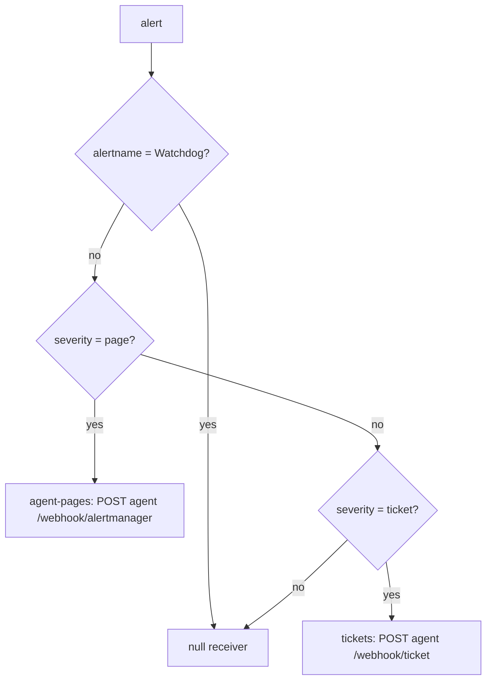

# Alerting

How alerts are defined, routed, grouped, inhibited and silenced. SLO thresholds
and windows are in the generated [slo-design.md](slo-design.md).

## Philosophy: page on symptoms, keep causes as evidence

- **Symptom alerts** (`class: symptom`) say that users are affected: the SLO
  burn-rate alerts and `ServiceDown`. They are what wakes someone up, or here,
  what starts the agent.
- **Cause alerts** (`class: cause`) say why: `CrashLoop`, `SaturationHigh`,
  `MemoryExhaustionPredicted`, and the pipeline alerts. They are evidence for
  the diagnosis and are **never inhibited**.

One cause alert pages on purpose: `MemoryExhaustionPredicted`. A leak causes
no user-visible symptom until the container is killed, so the prediction is
the only chance to act before impact.

Every alert carries the labels `severity` (`page`, `ticket`, or `none` for the
Watchdog), `service` and `class`, and the annotations `summary`,
`description`, `runbook_url` and `dashboard_url`.

## Alert inventory

| Alert | Severity | Class | Fires when | Runbook |
|---|---|---|---|---|
| `SLOBurnRateFast` | page | symptom | burn > 14.4 over 2m and 30s | per SLO |
| `SLOBurnRateSlow` | page | symptom | burn > 6 over 6m and 1m, for 10s | per SLO |
| `SLOBurnRateTicket` | ticket | symptom | burn > 3 over 15m and 3m, for 15s | per SLO |
| `SLOBurnRateTrickle` | ticket | symptom | burn > 1 over 30m and 5m, for 15s | per SLO |
| `ServiceDown` | page | symptom | a managed service has no healthy instance for 15s | [service-down](runbooks/service-down.md) |
| `MemoryExhaustionPredicted` | page | cause | RSS > 60% of limit and predicted > 90% within 60s, for 10s | [memory-exhaustion](runbooks/memory-exhaustion.md) |
| `CrashLoop` | ticket | cause | 2 or more process restarts in 2m | [crash-loop](runbooks/crash-loop.md) |
| `SaturationHigh` | ticket | cause | orders worker utilization > 0.9 for 30s | [saturation](runbooks/saturation.md) |
| `PrometheusTargetDown` | ticket | cause | a pipeline component cannot be scraped for 30s | [pipeline-health](runbooks/pipeline-health.md) |
| `AlertmanagerNotificationsFailing` | ticket | cause | notification failures in the last 5m | [pipeline-health](runbooks/pipeline-health.md) |
| `Watchdog` | none | meta | always | [pipeline-health](runbooks/pipeline-health.md) |

The windows above are the demo profile. SLO alerts exist once per SLO
(`gateway-availability`, `gateway-latency`, `orders-availability`,
`orders-latency`) and also require a minimum request rate, so an idle service
cannot alert. The SLO alerts are generated; the rest are handwritten in
`observability/prometheus/rules/handwritten/`.

`ServiceDown` is written as "managed services (from the CMDB) minus services
with a healthy instance" rather than `up == 0`. A container that is restarting
drops out of DNS discovery, so it has no `up` series at all; `up == 0` would
miss exactly the crash-loop case.

## Routing



- Pages start the agent's incident pipeline. Tickets only create ticket
  records; the agent never remediates on a ticket.
- Both webhooks use bearer authentication. Alertmanager reads the token from
  `.secrets/webhook_token` (mounted read-only); the agent compares it with
  `WEBHOOK_TOKEN`. Both come from `python -m tools.cli init`.
- `send_resolved: true`, so the agent also learns when an alert clears.
- An alert without a recognised severity is dropped. That is deliberate:
  every real alert is labelled.

## Grouping

Alerts are grouped by `[service, slo]`. All burn tiers of one SLO arrive as
one notification group, and cause alerts (no `slo` label) form one group per
service.

| Setting | Demo value | Meaning |
|---|---|---|
| `group_wait` | 5s | wait before the first notification of a new group (production: about 30s) |
| `group_interval` | 30s | wait before notifying about changes to a group |
| `repeat_interval` | 30m | re-send a still-firing group |

## Inhibition

Three rules reduce duplicate notifications:

1. **A page suppresses the ticket-level burn alert for the same `[service, slo]`.**
   If the fast burn is already paging, the trickle alert for the same SLO adds
   nothing. The target is limited to `class="symptom"` so cause alerts are
   never hidden.
2. **`ServiceDown` suppresses latency burn alerts for the same service.** A
   service that is down is trivially slow.
3. **An availability page suppresses the latency page for the same service.**
   One page per service; errors are the more severe signal.

Nothing inhibits `CrashLoop`, `SaturationHigh` or `MemoryExhaustionPredicted`.

Inhibition cannot be unit-tested with `amtool`, so it was checked against the
running Alertmanager on 2026-11-12 by posting synthetic alerts for a test
service and reading back each alert's `inhibitedBy` status:

| Alert posted | Result |
|---|---|
| `SLOBurnRateFast` (page, availability) | active |
| `SLOBurnRateFast` (page, latency), with `ServiceDown` present | inhibited by `ServiceDown` (rule 2) |
| `SLOBurnRateFast` (page, latency), without `ServiceDown` | inhibited by the availability page (rule 3) |
| `SLOBurnRateTicket` (ticket, availability) | inhibited by the availability page (rule 1) |
| `CrashLoop`, `SaturationHigh` (ticket, cause) | active |
| `MemoryExhaustionPredicted` (page, cause) | active |

Rule 1 was also observed with a real fault: during a 75-second 50% error
fault on orders the ticket and trickle alerts showed as inhibited while the
pages fired, and were delivered to the ticket receiver once the pages
resolved.

## Detection time

One real run on 2026-11-12 (50% errors injected on orders at 20 rps, single
machine, n = 1):

| Event | Time after injection |
|---|---|
| `SLOBurnRateFast` firing in Prometheus (orders, then gateway) | 14 s and 16 s |
| Page delivered to the agent webhook | 20 s and 21 s |

This is one observation, not a benchmark. Measured detection times across
scenarios come from the evaluation harness (`docs/evaluation.md`).

## Silences

Silences mute notifications for planned work without changing any rule.

```
python -m tools.cli silence --service orders --minutes 15 --comment "db maintenance"
python -m tools.cli silence --list
python -m tools.cli silence --expire <id>
```

The same with `amtool` inside the Alertmanager container:

```
docker compose exec alertmanager amtool silence add service=orders \
  --duration=15m --comment="db maintenance" --alertmanager.url=http://localhost:9093
docker compose exec alertmanager amtool silence query --alertmanager.url=http://localhost:9093
```

A silenced alert still fires in Prometheus and is still visible in
Alertmanager (state `suppressed`); only the notification is withheld, so the
agent does not act on it. Always set an end time and a comment.

## Dead man's switch

`Watchdog` fires permanently and is routed to the null receiver. It proves
that rules are being evaluated and that Prometheus can reach Alertmanager.
`python -m tools.cli verify-pipeline` checks that it is present, and also
sends a synthetic page through Alertmanager to the agent to prove delivery
and authentication. In production the Watchdog would be sent to an external
heartbeat service that pages when the heartbeat stops.

## Testing

| What | How |
|---|---|
| Rule syntax and Prometheus config | `python -m tools.cli slo validate` (`promtool check rules`, `promtool check config`) |
| Alerts fire and stay quiet at the right moments | `python -m tools.cli test-rules` (`promtool test rules` on `observability/prometheus/tests/`) |
| Alertmanager config and routing | `python -m tools.cli test-rules` (`amtool check-config`, `amtool config routes test` cases in `observability/alertmanager/tests/routes.yml`) |
| Live pipeline | `python -m tools.cli verify-pipeline` |

promtool and amtool run from the pinned Prometheus and Alertmanager images,
so nothing needs to be installed on the host.
